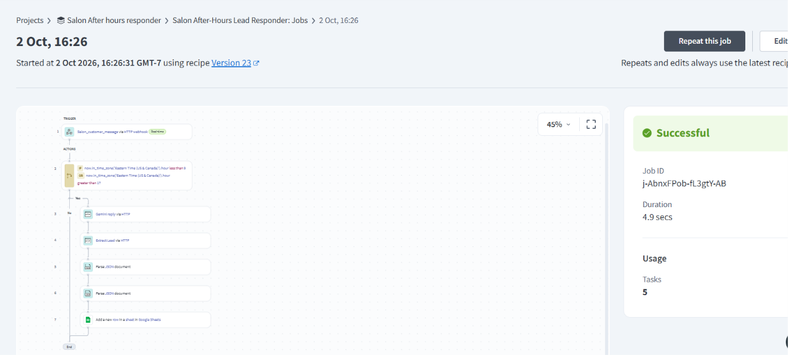
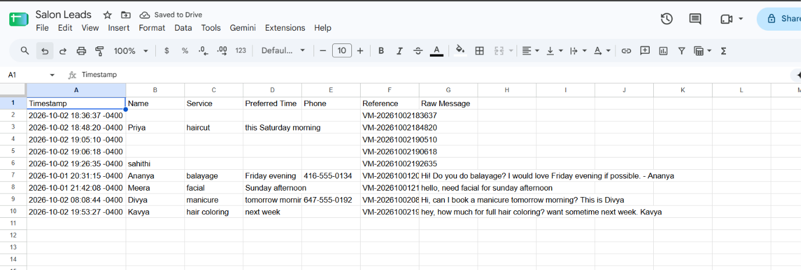

# Salon After-Hours Lead Responder

An AI-powered lead capture automation for **Velvet Mane Salon & Spa** (a fictional demo salon). When customers message after closing time, the system greets them, holds a short conversation, and saves their booking requests as leads — so no customer is lost overnight.

Built by **Sahithi Patiki** as portfolio project #1 of a freelance AI-automation practice.

## Live demo

**[Velvet Mane Salon & Spa](https://muse.ai/s/demo-salon-website-2-xke6i42mxkxfkxi/UhuTbj9tV3YIMuupyrDnibn682VasJzBCTqiMS-YU4A)** — open the page and send a message in the chat to see the customer experience.

## How it works

1. A visitor sends a chat message on the website.
2. The site fires the message to a Workato webhook (`salon_customer_message` event).
3. The recipe checks the time — it only runs after hours (before 9 AM or after 6 PM Eastern).
4. Google Gemini writes a warm, on-brand reply mentioning the salon is closed.
5. A second AI pass extracts the lead: name, service, preferred time, phone.
6. The lead is saved to a Google Sheet for the owner to follow up in the morning.

## Screenshots

*The full recipe: webhook trigger, after-hours gate, two Gemini calls, two Parse JSON steps, Google Sheets write.*

*A real run: every step green in under 5 seconds.*

*Extracted leads landing in the sheet — name, service, preferred time, phone, reference.*

## Repository contents

- `Workato Recipie.png` — recipe canvas screenshot
- `Sucessfull_Job.png` — successful job run screenshot
- `Leads_captured.png` — leads sheet screenshot
- `README.md` — this file

## Tech stack

- **Workato** — webhook trigger, after-hours IF logic, HTTP actions, Parse JSON steps, Google Sheets connector
- **Google Gemini** (`gemini-3.8-flash`) — reply generation and lead extraction via the `generateContent` API
- **Google Sheets** — lead storage (`Salon Leads`: Timestamp | Name | Service | Preferred Time | Phone | Reference | Raw Message)
- **Static website** (HTML/CSS/JS) — the customer-facing demo with chat widget

## Key build decisions

- **Recipe over agent framework:** the flow is deterministic (trigger → check → AI → parse → save), so a recipe with AI steps is the right tool — AI is used for language understanding and reply writing, not for orchestration.
- **Prompt engineering matters:** the reply prompt explicitly handles greetings ("hi" alone gets a greeting back, not treated as a service) and steers tone and length.
- **Structured extraction:** the AI returns *only* a JSON object `{name, service, preferred_time, phone}`, parsed with Workato's Parse JSON actions (empty string for anything not mentioned).
- **Honest status reporting:** the website's "Live link" indicator only reports success after a real HTTP 200 from the webhook.

## Sample data

The Google Sheet contains sample demo leads (fictional customers) for illustration.

## What's next

- 8 AM owner-summary email — a scheduled recipe that emails the morning's leads
- Demo #2: review requester + review rescue engine
